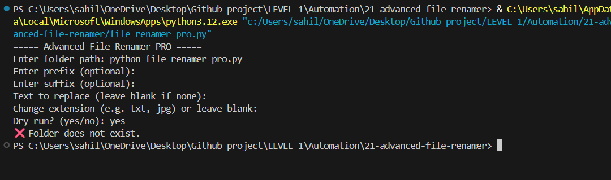

# Advanced File Renamer PRO

A small Python command-line utility for applying consistent naming rules to multiple files in a folder.



> **Status:** Portfolio utility. Always test with a disposable folder first. The current script previews proposed names in dry-run mode, but it does not yet provide undo/history or robust destination-collision handling.

## Features

- Add a prefix to each filename.
- Add a suffix before the extension.
- Replace text in the filename.
- Optionally set a new extension.
- Append sequential numbering to generated names.
- Preview proposed changes with dry-run mode.
- Uses Python's standard library; no third-party packages required.

## Requirements

- Python 3.10 or newer recommended
- Windows, macOS, or Linux

## Run locally

1. Clone or download this repository.
2. Open a terminal in the project directory.
3. Check Python is installed:

   ```bash
   python --version
   ```

4. Run the script:

   ```bash
   python file_renamer_pro.py
   ```

On some systems, use `python3 file_renamer_pro.py`.

## Interactive prompts

The script asks for:

1. **Folder path** — the existing folder containing files to rename.
2. **Prefix** — optional text placed at the start of each filename.
3. **Suffix** — optional text placed after the filename and before the extension.
4. **Text to replace** — optional substring in the filename.
5. **Replace with** — replacement text, if a search string was entered.
6. **Change extension** — optional new extension, such as `txt` or `jpg`.
7. **Dry run?** — answer `yes` to preview proposed names without renaming files.

Example:

```text
===== Advanced File Renamer PRO =====
Enter folder path: C:\Users\YourName\Documents\sample
Enter prefix (optional): project_
Enter suffix (optional): _final
Text to replace (leave blank if none): draft
Replace with: report
Change extension (e.g. txt, jpg) or leave blank:
Dry run? (yes/no): yes
```

This is an illustrative input example; use a real test folder path on your machine.

## Naming example

For a file named `draft_notes.txt`, using prefix `client_`, suffix `_final`, replacement `draft` → `report`, and numbering enabled by the current script, the proposed name is similar to:

```text
client_report_notes_1_final.txt
```

The numeric suffix is currently added automatically to every generated filename, starting at 1 for each run.

## Safety notes and known limitations

- Start with dry-run mode and review every proposed name.
- Use a copy of your files for the first real run.
- The script currently does not check for duplicate generated names or safely plan around destination-name collisions. A rename can fail or behave differently across operating systems if the destination already exists.
- There is no undo or rollback history yet.
- The extension option changes the filename extension only; it does not convert the file's content or format.
- Files are processed in the order returned by the operating system, which is not guaranteed to be alphabetical.
- Only files directly inside the chosen folder are processed; subfolders are not traversed.
- Tests have not been claimed as run for this repository.

## Project structure

```text
21-advanced-file-renamer/
├── file_renamer_pro.py
├── Screenshot.png
└── README.md
```

## Roadmap

- Add destination-collision checks and a clear conflict policy.
- Add a confirmation step before applying changes.
- Add automated tests using temporary directories.
- Add undo/history support.
- Add optional alphabetical or date-based ordering.
- Add command-line flags for repeatable automation.

## Author

**Sahil Kumar** — Python automation and software development portfolio.

---

This README documents the current implementation and its known limitations rather than implying unimplemented safeguards.
